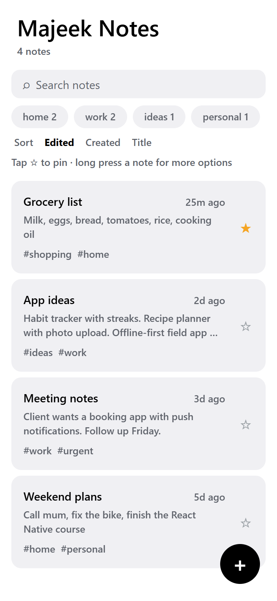
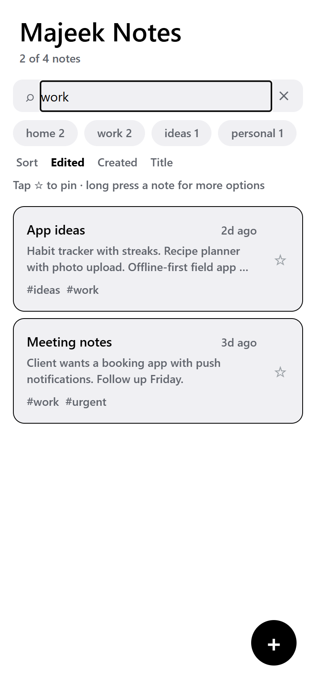
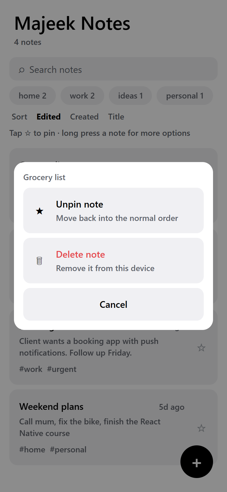
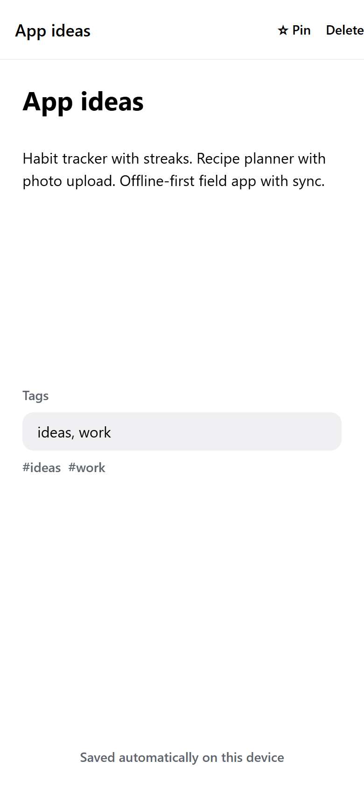
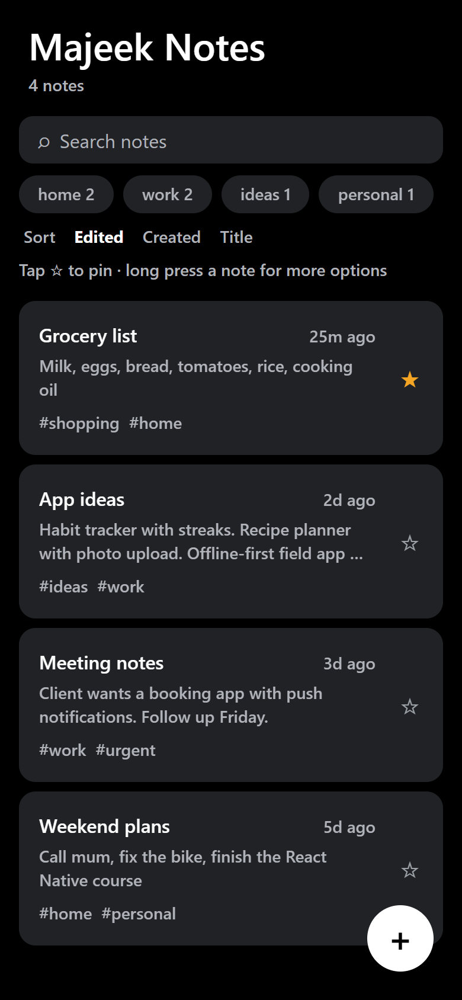
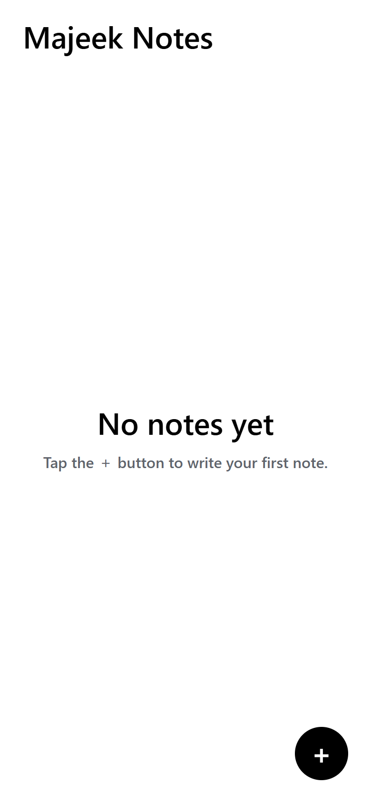
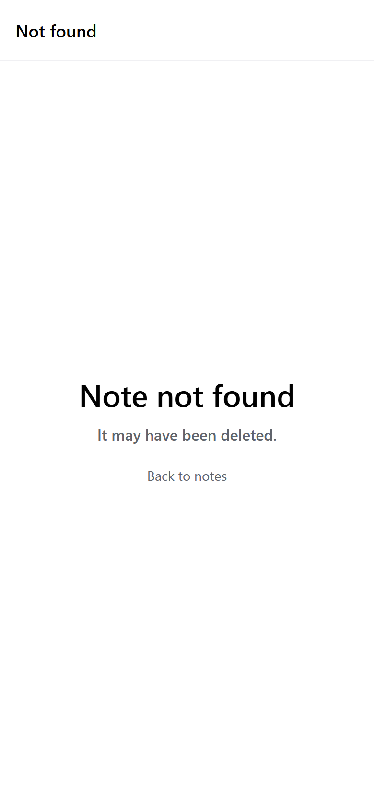

# Majeek Notes

A minimal, offline-first notes app built with **Expo SDK 57 + Expo Router + TypeScript**.

Built as **portfolio app #1** in a deliberate progression from simple to complex. The goal of this
app is to demonstrate navigation, forms, list rendering, and local persistence — not to compete with
a full note-taking product.

---

## Screenshots

All captured at a 390×844 phone viewport. Regenerate them with
`node scripts/capture-screenshots.js` (requires the dev server on port 8081).

| Notes list | Search & tag filter | Long-press actions |
|---|---|---|
|  |  |  |

| Note editor | Dark mode |
|---|---|
|  |  |

| Empty state | Not found |
|---|---|
|  |  |

---

## Where your notes are stored

**Entirely on your device. There is no server, no cloud, and no network call.** Nothing leaves the
phone.

| Platform | Where the data lives |
|---|---|
| Android | A **SQLite** database named `RKStorage` in the app's private data directory |
| iOS | A file in the app sandbox (`RCTAsyncLocalStorage_V1`) |
| Web (preview) | The browser's `localStorage` |

| Event | Do notes survive? |
|---|---|
| Closing or backgrounding the app | ✅ Yes |
| Restarting the phone | ✅ Yes |
| App update | ✅ Yes |
| **Uninstalling the app** | ❌ **No — wiped** |
| Android "Clear data" | ❌ No |

**No cross-device sync.** Device A's notes are invisible on Device B — that requires a backend, which
this app deliberately does not have. Sync starts at App #4 (Majeek Habits, Supabase-backed).

⚠️ AsyncStorage is **unencrypted** — fine for notes, unsuitable for secrets. A password app would
need `expo-secure-store`.

See [`docs/CONVENTIONS.md`](../../docs/CONVENTIONS.md) §2 for the full storage model.

---

## Features

- **Create, edit, and delete notes** — full CRUD
- **Search** across titles, bodies **and tags**
- **Tags** — comma-separated, normalised to lowercase, with a tap-to-filter chip row
- **Pinning** — pinned notes stay above everything, in any sort order
- **Sorting** — by last edited, date created, or title
- **Two-screen flow** (list → editor) using Expo Router's file-based navigation
- **Long-press menu** with pin and delete actions
- **Autosave** — debounced writes (400 ms) plus a flush on screen exit, so nothing is lost
- **Persistent storage** via AsyncStorage — notes survive a full app restart
- **Light / dark mode** — follows the system setting
- **Delete confirmation** — works on both native and web
- **Accessible** — labelled buttons and list rows for screen readers
- **Empty states** — clear calls to action for no notes, and for no search results

---

## Tech stack

| Concern | Choice | Notes |
|---|---|---|
| Framework | Expo SDK 57 | React Native 0.86, React 19.2 |
| Navigation | Expo Router | File-based, typed routes |
| Language | TypeScript | `strict` mode, no `any` |
| Storage | AsyncStorage | Bundled in Expo Go — no custom build needed |
| State | React Context + `useRef` | No state library needed at this size |
| Theming | `useColorScheme` + theme constants | Inherited from the Expo template |

### Why AsyncStorage and not MMKV

MMKV is faster but requires native code, which means **Expo Go can't run it** — the app would need a
custom development build. AsyncStorage is bundled inside Expo Go, keeping the free QR-code workflow
intact. For a notes app of this size the performance difference is irrelevant.

---

## Project structure

```
src/
├── app/                      # Expo Router — every file here is a screen
│   ├── _layout.tsx           # Stack navigator + providers
│   ├── index.tsx             # Notes list
│   └── note/
│       └── [id].tsx          # Note editor (dynamic route)
├── components/
│   ├── note-row.tsx          # A single row in the list
│   ├── themed-text.tsx       # (template) text with theme colours
│   └── themed-view.tsx       # (template) view with theme colours
├── constants/theme.ts        # Colour palette, spacing, fonts
├── hooks/
│   ├── use-notes.tsx         # Notes state + all mutations
│   ├── use-theme.ts          # Resolves the active colour set
│   └── use-color-scheme.ts   # System colour scheme
├── lib/
│   ├── storage.ts            # AsyncStorage read/write + shape migration
│   ├── notes-query.ts        # search / tag filter / sort (pure functions)
│   ├── format.ts             # Relative date formatting
│   └── confirm.ts            # Cross-platform confirm dialog
└── types/
    └── note.ts               # Note type, factories, tag parsing, normaliser
```

### Architecture notes

- **State lives above the navigator.** Both screens mutate the same collection, so `NotesProvider`
  wraps the `Stack` in `_layout.tsx`. This keeps the list and editor in sync without prop drilling.
- **The editor owns a local draft.** Reading the note from context on every keystroke would fight the
  local state, so initial values are captured once and the draft is local from then on.
- **Saves are debounced but flushed on exit.** A 400 ms debounce avoids hammering AsyncStorage while
  typing; an unmount effect guarantees pending edits are written before leaving.
- **Pinning does not touch `updatedAt`.** Pinning is not an edit, and bumping the timestamp would make
  a pinned note claim it was "just edited" and reorder the list unexpectedly.
- **Queries are pure functions.** `notes-query.ts` holds the search, filter and sort rules, so the
  behaviour is stated in one place and testable without rendering anything.
- **Stored data is normalised on read.** `normalizeNote()` back-fills fields added after the first
  release (`tags`, `pinned`) and drops unusable entries. Adding those fields did **not** require a
  storage-key bump, so existing notes were never lost.
- **Interactive elements are siblings, not nested.** Putting the pin button inside the tappable row
  rendered `<button>` inside `<button>` on web — invalid HTML that breaks hydration. The row and its
  pin rail are now siblings.

---

## Getting started

### Prerequisites

- **Node.js ≥ 22.13** (required by Expo SDK 57)
- **Expo Go** on a physical device, or an Android emulator / web browser

### Run it

```bash
npm install
npx expo start
```

Then either:

- **Scan the QR code** with Expo Go (phone must be on the same Wi-Fi network)
- Press **`w`** for the browser
- Press **`a`** for an Android emulator

### Useful commands

```bash
npx tsc --noEmit    # type check
npx expo lint       # lint
npx expo-doctor     # diagnose dependency/config issues
```

---

## What I learned building this

- **Expo Router** maps files to routes the same way Next.js App Router does — `src/app/note/[id].tsx`
  becomes `/note/:id`. Typed routes mean a bad `router.push()` is a compile error.
- **Expo Go only bundles a fixed set of native modules.** Choosing a library with native code forces a
  development build and breaks the free QR workflow. Checking `inExpoGo` in the Expo docs first saved
  a rewrite here.
- **Debounced autosave needs an explicit flush.** Relying on the debounce alone loses the final
  keystrokes if the user leaves immediately.
- **`Alert` doesn't exist on react-native-web.** Platform-specific fallbacks are needed for anything
  that isn't pure UI. The long-press menu uses a `Modal` instead, because web's `confirm()` only
  offers two buttons and could never host Pin + Delete + Cancel.
- **Additive fields don't need a storage-key bump.** `tags` and `pinned` were added without changing
  the key; a normaliser back-fills defaults on read instead. Bumping the key would have made every
  existing note vanish, which is far worse than a one-line migration.
- **Nested pressables are invalid HTML.** A `Pressable` inside a `Pressable` renders nested `<button>`
  elements on web, breaking hydration and screen readers. Sibling layout avoids it.

## Known limitations

- Tags are free-text with no autocomplete, so typos create separate tags
- No tag renaming or deletion from a single place
- No rich text formatting
- Search is a simple substring match — no fuzzy matching or ranking
- Storage is unencrypted (fine for non-sensitive notes; SecureStore would be needed otherwise)
- No sync across devices

## Possible next steps

- Tag autocomplete and a tag-management screen
- Bulk selection for multi-delete or multi-tag
- Move to `expo-sqlite` if the note count grows large
- Optional Supabase sync for multi-device support

---

## License

MIT
